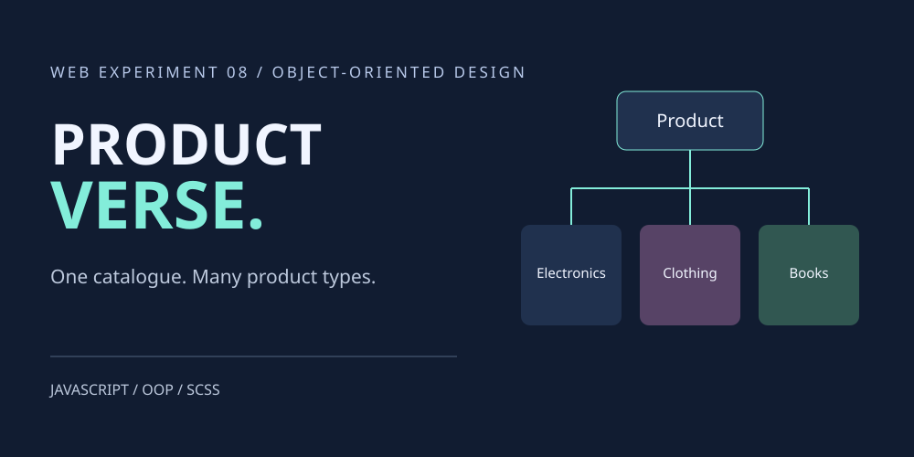

# ProductVerse — OOP Product Showcase



A dynamic product catalogue for Web Experiment 08, demonstrating JavaScript inheritance, polymorphism, reusable SCSS partials and responsive interface design.

**Status:** Academic project / implemented frontend prototype. Browser, Sass compilation and live deployment verification pending.

## Features
- Six original sample products across electronics, clothing and books.
- Product base class and three subclasses with overridden category and specification methods.
- Shared polymorphic rendering without type-specific branches for product details.
- Search, category filtering, price sorting and expandable specifications.
- Local cart with integer-cent prices, quantities, removal and demo checkout.
- Light, dark and system appearance with saved preference.
- Responsive layouts, keyboard-visible focus and local concept graphics.

## Run locally

Open index.html or serve the root with:

```bash
python -m http.server 8000
```

Visit http://localhost:8000. The checked-in CSS requires no build for browsing.

## SCSS architecture

`styles/main.scss` loads the variables, mixins, themes, base and component partials using Sass modules. To rebuild the stylesheet, install Dart Sass in your development environment and run:

```bash
sass --no-source-map styles/main.scss styles/main.css
```

The checked-in CSS is maintained alongside the SCSS source. Compilation has not yet been verified here.

## Files

- `scripts/products.js`: Product, Electronics, Clothing, Book, sample data and catalogue/cart logic.
- `scripts/main.js`: DOM rendering, controls and local storage.
- `styles/`: SCSS source and browser-ready CSS.
- `tests/products.test.js`: regression tests.
- `assets/cover.svg`: original project concept artwork.

## Tests

Node.js 18+:

```bash
node --test tests/products.test.js
```

Manual browser checks: filters, expand specifications, quantity changes, reload, theme switching, keyboard navigation and responsive layouts.

## Limitations

All products, brands, specifications and prices are illustrative. There are no real orders, payments, backend, authentication or inventory. No live URL is listed until verified.
